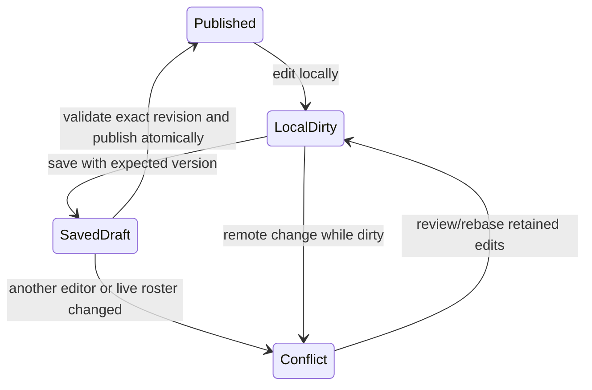

# Schnitzery principal engineering and product audit — 12 November 2026

## Verdict and evidence boundary

This is a substantial custom operations portal with real business workflows, not an empty prototype. It is not yet defensible as an enterprise-grade scheduling system: database-authoritative publication rules, concurrency around destructive actions, incomplete-data handling, and role-specific navigation need work before another cosmetic overhaul.

Audited checkout: `E:\Github Projects\Schnitzery`, HEAD `2e818ce`, including the current uncommitted files. The older Codex worktree is not the audit target. Other work is present in this dirty checkout; this audit did not revert it. Findings refer to the source as read, and can move if concurrent edits continue.

Stack: Next.js 16.4.3 App Router, React 19.3.1, TypeScript 5.9, Supabase/Postgres/Auth/Storage/Realtime, Tailwind 4 plus a large global stylesheet, Vitest, Playwright, GitHub Actions, Vercel, Capacitor Android, Sentry. Package versions here are local package.json facts, not compatibility certification.

Coverage: source-wide pattern scan of 352 TS/TSX/CSS files, 88 page components, 436 button opening tags and 409 inline-style sites at scan time; targeted semantic reads of the critical shell, navigation, roster, availability, profile, inventory, owner, database and infrastructure paths below. See the coverage CSV for file hashes. These counts are not bug counts. This is not a claim that every line or every runtime role flow was verified. Credentials, environment files, private historical migrations, exports and unrelated Supabase MCP were excluded. The existing graph was queried once with a 1,200-token output budget, not rebuilt; new source was authoritative. Exact total model token usage is not available.

No deploys, pushes, production access/writes, dependency installs, or application-source fixes were performed. New files are audit documentation/inventories and a pure reproduction check. No four-role pixel review, production RLS certification, latency benchmark, full build or new browser suite run is claimed.

## 1. Multi-portal UI/UX and design system

### Confirmed usability defects

| ID / priority | Source anchor, relative to E:\Github Projects\Schnitzery | Problem and correction |
| --- | --- | --- |
| UX1 / P2 | [src/components/AvailabilityForm.tsx:72](<E:/Github Projects/Schnitzery/src/components/AvailabilityForm.tsx:72>), [src/app/(app)/my-day/page.tsx:17](<E:/Github Projects/Schnitzery/src/app/(app)/my-day/page.tsx:17>) | Week navigation replaces local availability without a dirty check. Changing My Day tabs unmounts the form and loses edits. Keep saved/draft snapshots, confirm before week/tab exits, retain drafts by user+branch+week, and show an unsaved state. Do not just add a back arrow. |
| UX2 / P2 | [src/app/(app)/my-day/page.tsx:23](<E:/Github Projects/Schnitzery/src/app/(app)/my-day/page.tsx:23>), `:38` | Four view-switch buttons have no selected-state semantics; tabs exist only in local state. Reload/back returns to Availability instead of the prior Time off/Hours/Work view. Put the view in `?tab=`, use links with `aria-current` or implement complete tab/tabpanel keyboard semantics. Preserve a dirty form before switching. |
| UX3 / P2 | [src/app/(app)/expiry/page.tsx:42](<E:/Github Projects/Schnitzery/src/app/(app)/expiry/page.tsx:42>), [src/components/InventoryNav.tsx:33](<E:/Github Projects/Schnitzery/src/components/InventoryNav.tsx:33>), [src/components/EmployeeBack.tsx:18](<E:/Github Projects/Schnitzery/src/components/EmployeeBack.tsx:18>) | Shift leaders enter expiry from /shift but receive manager inventory navigation, including links to denied manager routes. EmployeeBack also routes expiry to Home. Pass a capability/role-scoped navigation variant and return shift leaders to /shift. Keep manager controls and costs restricted on the server. |
| UX4 / P2 | [src/app/(app)/overview/page.tsx:22](<E:/Github Projects/Schnitzery/src/app/(app)/overview/page.tsx:22>), `:30` | Overview promises have no rejection handling; a failed overview can leave skeletons forever, and an older period response can overwrite a newer comparison. Use explicit loading/error/data states and an effect cleanup/sequence guard. Distinguish unavailable data from access denied. |
| UX5 / P2 | [src/app/(app)/overview/page.tsx:116](<E:/Github Projects/Schnitzery/src/app/(app)/overview/page.tsx:116>) | `laborCost ? ... : '—'` displays a real zero cost as missing and formats money manually to whole euros. Use `laborCost == null`, `formatEur`, coverage indicators and the same precision policy as other financial screens. Confirm the line after concurrent edits; search for `b.laborCost ?`. |
| UX6 / P2 | [src/app/(app)/inventory/consumption/page.tsx:28](<E:/Github Projects/Schnitzery/src/app/(app)/inventory/consumption/page.tsx:28>), `:29`, `:35` | Sales selection, nested ingredient lists, posting confirmation, mapping editor and history share one long surface. The hierarchy makes setup compete with the operator's primary task. Show a sales-review table (date, SKU, sold, recipe, status), ingredient detail on expansion, one review/action footer, and a separate mapping setup task. Keep actual stock-impact warnings visible. |

### Design issues and recommendations, not fabricated pixel failures

- The palette is already coherent: light slate/white surfaces with teal action, and a separate dark palette ([src/app/globals.css:1](<E:/Github Projects/Schnitzery/src/app/globals.css:1>), `:21`). Keep it. A new palette alone will not repair workflow hierarchy.
- Action text contrast passed: dark 7.72:1, light 6.69:1. This does not test every team badge, disabled control or selected tab. `TEAM_COLORS` still hardcodes purple at [src/app/(app)/roster/page.tsx:24](<E:/Github Projects/Schnitzery/src/app/(app)/roster/page.tsx:24>); use a semantic team token and test both themes before asserting a contrast failure.
- Shared controls already use 44px minimum height and 8px radius ([src/app/globals.css:188](<E:/Github Projects/Schnitzery/src/app/globals.css:188>), `:199`, `:527`, `:594`). Compact desktop buttons intentionally use 36px (`:724`); that is a valid density variant, not automatically an accessibility bug. `.prep-seg button` independently forces 36px at `:1256` even on touch screens. Apply the density contract consistently instead of more per-page overrides.
- The roster already has seven desktop columns at [src/app/globals.css:1177](<E:/Github Projects/Schnitzery/src/app/globals.css:1177>); the old “mobile cards stretched over desktop” accusation would be outdated. At the 1100px breakpoint, subtracting the 240px sidebar leaves narrow day columns. Use a dedicated horizontal week canvas with a tested minimum column width, or a 3/4-column intermediate layout, then 7 columns when the content container actually fits. This is a source-based layout risk pending viewport screenshots, not a measured overflow claim.
- [src/components/ui.tsx:10](<E:/Github Projects/Schnitzery/src/components/ui.tsx:10>) and `:18` already provide PageHeader/Panel. Use those consistently. Different page-local header shapes and mixed action placement are more damaging than whether a card radius is 12px or 14px.
- [src/components/ManagementNav.tsx:59](<E:/Github Projects/Schnitzery/src/components/ManagementNav.tsx:59>) provides section-level back links, and [src/components/InventoryNav.tsx:67](<E:/Github Projects/Schnitzery/src/components/InventoryNav.tsx:67>) provides contextual inventory back links. Back navigation is not globally absent. The gap is deep parent/query context and role correctness. Extend the existing navigation mapping; do not create a second competing global breadcrumb registry.
- [src/app/(app)/shift/page.tsx:24](<E:/Github Projects/Schnitzery/src/app/(app)/shift/page.tsx:24>) intentionally caps an employee-style task launcher at 680px. No live KPI panel exists on that page, so I cannot honestly report overlapping live metrics there. At larger widths use two task columns if floor staff actually use desktop, while preserving scan-friendly touch targets.
- 436 button locations are listed in `PRINCIPAL-AUDIT-BUTTONS-2026-11-12.csv`. This includes loop definitions and test source if present; it is not the number of rendered controls. Static tags cannot establish computed size/alignment. The remaining acceptance work is computed-style and screenshot verification at 390, 768, 1280 and 1440px, both languages/themes and four roles.

### Global token contract

Reuse the existing semantic variables; do not introduce another theme or Button factory. Apply one of two explicit sizes to every interactive control. Mixed sizes in one toolbar are allowed only when the compact controls are a subordinate navigation group.

```css
:root { --control-h: 44px; --control-h-compact: 36px; --control-radius: var(--radius-sm); }
.btn-gold, .btn-secondary, .btn-danger, .btn-quiet-danger {
  display: inline-flex; align-items: center; justify-content: center;
  gap: var(--space-2); min-height: var(--control-h);
  border-radius: var(--control-radius); line-height: 1.25;
  padding-inline: var(--space-4); font-size: var(--text-md);
}
.ui-actions { display:flex; flex-wrap:wrap; align-items:center; gap:var(--space-2); }
.form-actions { display:flex; flex-wrap:wrap; align-items:flex-end; gap:var(--space-3); }
@media (pointer:fine) {
  .ui-btn-sm { min-height:var(--control-h-compact); font-size:var(--text-sm); }
}
@media (pointer:coarse) {
  .prep-seg button, .roster-copy { min-height:var(--control-h); }
}
```

Merge this contract into the existing matching rules; do not append repeated overrides indefinitely. Keep body 14–16px, secondary labels 13px, metadata 12px, section headings 16–20px, page titles 24px. Dynamic chart widths and avatar sizes are legitimate inline styles; delete duplication, not every inline style on principle.

### Feature placement by portal

| Portal | First screen | Secondary tasks | Editing/detail surface |
| --- | --- | --- | --- |
| Employee | Today / next shift / clock status | My Day: availability, time off, hours, work | One focused form; sticky Save only when dirty; URL-preserved tab |
| Shift leader | Current service tasks and exceptions | Prep, stocktake, delivery, expiry/use/waste, day close | Branch/date fixed; no prices/order-management links |
| Branch manager | Exceptions, staffing and operations status | Workforce, inventory, daily operations, reporting | Roster week canvas; consistent drawers/dialogs; branch/date remains visible |
| Brand owner | Comparable branch performance with data coverage | Branch drill-down, payroll status, system exceptions | Preserve selected branch/period when returning; unknown cost never becomes zero |

For inventory retain the existing six areas; do not add another menu layer: Overview, Stock, Purchasing, Kitchen, Movements, Reports. Put catalog/units/packs under Stock setup; orders/suppliers/receiving/returns under Purchasing; recipes/prep/production under Kitchen; ledger/transfers/waste under Movements; valuation/traceability/variance under Reports. Link between related records, rather than repeating every feature as dashboard tiles.

## 2. Concurrency, isolation, hydration and frontend state

| ID / priority | Exact source | Confirmed source behavior, impact and correction |
| --- | --- | --- |
| ENG1 / P1 | [src/lib/queries/schedule.ts:228](<E:/Github Projects/Schnitzery/src/lib/queries/schedule.ts:228>), `:232`; [supabase/migrations/20261111120000_roster_publish.sql:52](<E:/Github Projects/Schnitzery/supabase/migrations/20261111120000_roster_publish.sql:52>), `:58` | Working-time rules inspect a draft in separate requests before the publish transaction locks/reads it. Another manager can replace it in between; the transaction publishes the later, unchecked draft. Authorized managers can also call publish_roster directly, bypassing server-action rule checks. Require a checked draft revision/snapshot and enforce invariants inside the authoritative transaction. Row locking alone does not validate business rules. |
| ENG2 / P1 | [src/lib/roster/check.ts:34](<E:/Github Projects/Schnitzery/src/lib/roster/check.ts:34>), `:47`; [src/lib/roster/smart.ts:133](<E:/Github Projects/Schnitzery/src/lib/roster/smart.ts:133>); [src/lib/roster/draft.ts:46](<E:/Github Projects/Schnitzery/src/lib/roster/draft.ts:46>) | Day-index ×1440 plus wall-clock minutes is not elapsed time across DST. Reproduced: 28 Mar 2026 22:00 CET → 29 Mar 09:00 CEST is 10h, but checkRoster returns no issue. Use actual Europe/Berlin instants and calendar-day rollover; explicitly handle ambiguous/nonexistent local times. |
| ENG3 / P2 | [src/lib/queries/schedule.ts:249](<E:/Github Projects/Schnitzery/src/lib/queries/schedule.ts:249>) | Discard deletes the current branch/week draft without comparing the version the manager reviewed. A concurrent newer draft can be deleted. Require expected snapshot/revision, compare in the DELETE, select the deleted row, and report a conflict on zero affected rows. |
| ENG4 / P2 | [src/lib/queries/people.ts:143](<E:/Github Projects/Schnitzery/src/lib/queries/people.ts:143>), `:145`; `:46`, `:51` | updateStaff guards are optional and skills are explicitly excluded. updateMyProfile reads team skills then writes the whole array without CAS. A stale profile save can restore an outdated qualification or overwrite a manager edit. Use one row-version CAS for every profile write, including self-service, and enforce qualification ownership in the database. |
| ENG5 / P2 | [src/lib/queries/availability.ts:88](<E:/Github Projects/Schnitzery/src/lib/queries/availability.ts:88>), `:94` | Monthly saves issue separate updates/inserts; Every week first saves the week then updates the default. Partial failure leaves a partially applied promise, and read-then-insert races produce conflicts. Put the chosen scope in one transactional RPC, use the existing unique keys and explicit conflict semantics, and return the affected weeks/version. |
| ENG6 / P2 | [src/app/(app)/roster/page.tsx:279](<E:/Github Projects/Schnitzery/src/app/(app)/roster/page.tsx:279>) | Realtime events received while busy or inside the blanket four-second own-save window are discarded permanently. Another manager's update in that interval can leave a clean client stale. Queue invalidation until idle, coalesce it, and identify own events by revision/command ID instead of suppressing every event by time. |
| ENG7 / P2 | [src/app/(app)/roster/page.tsx:195](<E:/Github Projects/Schnitzery/src/app/(app)/roster/page.tsx:195>), `:247`, `:440`, `:452` | During publishing (saving=false), dragging/removing/week navigation remains enabled because controls check saving but not publishing. Publish then load() can replace edits made during the request. Use one mutation lock for all editors/navigation while publishing, or preserve a newer local edit generation and never overwrite it on acknowledgement. |
| ENG8 / P2 | [src/components/AvailabilityForm.tsx:89](<E:/Github Projects/Schnitzery/src/components/AvailabilityForm.tsx:89>), `:55` | Slot toggles remain active during saving. The save captures an earlier days snapshot; later edits stay onscreen while the success toast claims saved. Disable editing for one in-flight save or track the acknowledged snapshot and keep newer edits visibly unsaved. |
| ENG9 / P2 | [src/lib/queries/schedule.ts:218](<E:/Github Projects/Schnitzery/src/lib/queries/schedule.ts:218>); [src/lib/queries/owner-insights.ts:154](<E:/Github Projects/Schnitzery/src/lib/queries/owner-insights.ts:154>), `:162` | Failed planning/staff/log reads can degrade into empty Minijob constraints or zero worked time. A publication rule check must propagate incomplete coverage, not translate failure into no issues. Null wages also skip the calculation ([src/lib/pay/legal.ts:38](<E:/Github Projects/Schnitzery/src/lib/pay/legal.ts:38>)). Keep a distinct unknown outcome and require review/block according to policy. |

### What is already correct

- saveRoster uses an expected JSON snapshot when updating the draft (`src/lib/queries/schedule.ts:187–198`) and checks same-branch active staff before normalizing names (`:179–183`). It is not a blind overwrite in that server action.
- publish_roster already takes a branch/week advisory lock and row locks; it checks live roster against base_data. Keep that protection and add exact-draft rule validation; do not replace the application with global SERIALIZABLE transactions.
- The protected layout is keyed by user/branch/view ([src/app/(app)/layout.tsx:88](<E:/Github Projects/Schnitzery/src/app/(app)/layout.tsx:88>)), reducing cross-branch client-state carryover. The branch cookie is validated against accessible IDs ([src/lib/activeBranch.ts:33](<E:/Github Projects/Schnitzery/src/lib/activeBranch.ts:33>)). A cookie is not authorization.
- The roster channel unsubscribes ([src/app/(app)/roster/page.tsx:286](<E:/Github Projects/Schnitzery/src/app/(app)/roster/page.tsx:286>)), InventoryNav disconnects ResizeObserver ([src/components/InventoryNav.tsx:29](<E:/Github Projects/Schnitzery/src/components/InventoryNav.tsx:29>)), and AttendanceSync clears its interval/subscription. No memory leak is established in those paths.
- org-overview uses batched branch-ID reads, not a query per employee/branch ([src/lib/queries/org-overview.ts:51](<E:/Github Projects/Schnitzery/src/lib/queries/org-overview.ts:51>)). Do not invent an N+1 finding just because the returned objects are nested.

### Performance work with evidence

[src/lib/queries/inventory.ts:57](<E:/Github Projects/Schnitzery/src/lib/queries/inventory.ts:57>) retains compatibility fallback to full price/count history when summary functions are missing. [src/lib/supabase/readAll.ts:8](<E:/Github Projects/Schnitzery/src/lib/supabase/readAll.ts:8>) paginates up to 100,000 rows with an explicit failure beyond the ceiling. Missing summary functions can therefore turn a normal open into many sequential requests. Verify the summary RPCs and indexes, instrument fallback counts, and replace report-wide hydration with aggregates when measured volumes justify it.

[src/app/(app)/inventory/consumption/page.tsx:29](<E:/Github Projects/Schnitzery/src/app/(app)/inventory/consumption/page.tsx:29>) repeatedly finds mappings/recipes and renders all ingredient lists. Pre-index them with Map when the sales list is large, show collapsed details, and paginate before adding a virtualization dependency.

The 512-line roster component owns form state, swaps, live events, loading and the week canvas. Extract a pure DayColumn only after a React Profiler trace shows commit cost; stabilize unchanged day-array references and event handlers then memoize. useMemo is already used for labour estimates. No measured <50ms interaction or <200ms propagation guarantee exists; those are performance acceptance targets, not architectural promises.

## 3. Enterprise blueprints adapted to the existing stack

See `PRINCIPAL-AUDIT-BLUEPRINTS-2026-11-12.md` for concrete patches and invariants. They are review blueprints, not applied migrations or a substitute for the required integration tests.

### Preserve the existing dual-state model



weekly_roster already stores the published state, roster_drafts stores unpublished work, and base_data detects changes to the live baseline. Adding a second status enum to every historic attendance/payroll row would be unnecessary and risky. Add a revision or immutable publish event only where needed; keep historical consumers reading their existing tables.

The blueprint pack includes: compare-and-delete draft discard; revision/CAS profile writes; local optimistic edits without overwriting newer work; durable realtime invalidation; absolute-time rest checks; and URL-based parent/tab navigation.

## 4. Security, branch isolation and labour guardrails

### SEC1 / P1 — UI-only qualification and contract protection

[src/lib/queries/people.ts:44](<E:/Github Projects/Schnitzery/src/lib/queries/people.ts:44>) says team qualification changes belong to managers. However `supabase/migrations/20261024200000_security_hardening.sql:48–56` omits team, skills and contract_type from its sensitive predicate; the own-row path returns at :72, and the users_update policy permits own-row updates at :98. Direct authenticated table updates can therefore bypass the server action's team-skill filtering under the recorded policy/guard model. Protect team qualifications and contract classification at the database boundary; preserve allowed contact and ordinary skill edits. Verify actual column grants and the installed trigger on staging before calling this a demonstrated live exploit. No production exploit was attempted.

### SEC2 / P1 — database publication bypass

The authenticated RPC grants are explicit (`supabase/migrations/20261111120000_roster_publish.sql:69–74`). The function checks manager/branch but not the TypeScript rest/overlap rules, staff membership or the client-validated draft structure. Draft RLS authorizes a branch row, not every employee ID inside arbitrary JSON (`:19`). Move branch-member/active-person and scheduling invariant checks into the authoritative publish transaction. Merely hiding the Publish button does not close this path. Existing snapshot grants/policies for direct weekly_roster writes also need verification ([supabase/schema/production-schema.sql:1536](<E:/Github Projects/Schnitzery/supabase/schema/production-schema.sql:1536>)); changing write privileges must preserve cover approvals through a properly scoped RPC first.

### Branch A vs Branch B verification status

Branch ownership is intentionally single-brand Schnitzery with role-authorized branch access, not multiple unrelated tenant organizations. Brand owners are intentionally allowed all brand branches (`accessible_branch_ids`, production snapshot :1760). “Branch A can never read B” is correct for unassigned staff/managers, but not for explicitly authorized multi-branch owners. Define the matrix per role before writing negative tests.

Source checks support branch-cookie validation and branch-scoped roster RLS. They do not prove every production table/RPC is isolated. Required adversarial tests: staff A direct SELECT/INSERT/UPDATE/DELETE against branch B; manager A unassigned vs assigned B; guessed IDs and foreign IDs inside roster JSON; revoked/inactive accounts with existing JWT; definer RPCs; forged branch cookie; draft visibility to staff; grants and storage object ownership. Use synthetic staging users, never payroll/attendance production mutations. Inventory transfer/batch protections must be rechecked against their current installed definitions rather than relying on prior audit claims.

### Labour compliance: exact scope

- General rest is eleven uninterrupted hours; the restaurant-specific exception permits a reduction up to one hour only with compensating rest. The software's conservative 11h policy is reasonable, but silently accepting a DST-shortened rest is not an implementation of that exception. Compensation tracking would be a separate evidenced workflow. [ArbZG §§3–5](https://www.gesetze-im-internet.de/arbzg/BJNR117100994.html)
- The 2026 Minijob limit is €603 regular monthly earnings; official guidance also explains annual assessment and exceptions. A single-month overage is not automatically the entire legal classification. Keep the algorithm as a projection with known wages/data, not a legal certification. [Minijob-Zentrale](https://www.minijob-zentrale.de/DE/die-minijobs/minijob-mit-verdienstgrenze)
- checkRoster blocks only overlap/rest ([src/lib/roster/check.ts:12](<E:/Github Projects/Schnitzery/src/lib/roster/check.ts:12>)); hours and Minijob warnings can be overridden ([src/lib/queries/schedule.ts:231](<E:/Github Projects/Schnitzery/src/lib/queries/schedule.ts:231>)). This is current behavior, not strict cap enforcement. If the agreed business policy is hard caps, make that explicit and authoritative, with an audited exception process where appropriate.
- monthly_contract_hours ×12/52 is a planning estimate. It is not a complete legal overtime rule. Daily duration, breaks, averaging periods, paid/unpaid break handling, other employment, missing shift times, following Monday after this week's Sunday, and actual clocked work need coverage. The current checker sees previous Sunday but not next Monday (`src/lib/roster/check.ts:37–38`).
- Missing wages/times/logs must produce unknown coverage. A planned roster is not proof of actual compliance, and full enterprise labour enforcement is not complete merely because these five test files pass.

Infrastructure: CSP is explicitly report-only and script-src still allows unsafe-inline ([next.config.ts:20](<E:/Github Projects/Schnitzery/next.config.ts:20>), `:55`). This is deferred defense-in-depth, not evidence of a proven XSS exploit. Confirm telemetry, then stage a nonce/hash policy rather than switching to enforcement blindly. Preserve the legacy JWT setup and never expose the service key. [Postgres locking semantics](https://www.postgresql.org/docs/current/explicit-locking.html)

## 5. Priority roadmap with acceptance gates

| Phase / order | File groups and structural impact | Exit criteria |
| --- | --- | --- |
| 1A — data boundaries first | people.ts; users trigger migration; schedule.ts; publish RPC; check.ts/smart.ts/draft.ts | Direct RPC cannot bypass membership/rest/overlap rules. Exact reviewed draft published. DST fixture fails before/passes after. Two-editor save/publish/discard and profile-skill races preserve newer work. |
| 1B — recoverable UI | AvailabilityForm; My Day; roster client; overview; EmployeeBack/InventoryNav | No silent unsaved loss on week/tab/back. Publishing prevents or preserves newer edits. Realtime events during save trigger eventual refresh. Staff see only permitted inventory links. Owner errors show Retry, unknown and zero differ. |
| 1C — visual contract | globals.css; ui.tsx; ManagementNav; four portal representatives | One control-size/radius contract, aligned labels/input/actions, coherent semantic colors. Keyboard and 200% zoom checks. Screenshots at 390/768/1280/1440px EN/DE light/dark; no clipped content or hidden actions. |
| 2 — workflow hardening | availability defaults + save RPC; roster copy/columns; deep links | Reuse existing standing patterns and copyDay. Monthly/standing saves atomic. Never Monday survives reload; weekly overrides are clear. Week/day filters and parent return paths persist. Intermediate desktop calendar remains usable. |
| 3 — deterministic intelligence | smart.ts/draft.ts/cover checks; staffing targets; override canvas | Keep the existing rule-based engine. Shared authoritative constraints, deterministic tie-breaks, reasons for open slots, unknown-data coverage, audited overrides, keyboard alternative to drag-and-drop, fairness tests. Add forecasts only after historical coverage supports them. No LLM is needed for basic scheduling. |

These are dependency-ordered work packages, not invented calendar promises. Stabilize Phase 1 before expanding automation. Do not rebuild the portal in Lovable or another framework to solve these defects.

### Verification completed in this audit

- Five targeted Vitest files: 24 tests PASS (roster check, draft, smart, availability week logic, pay/legal).
- a11y-static PASS: naming checks across 168 files; not a complete WCAG audit.
- action-contrast PASS: dark 7.72:1; light 6.69:1.
- design-tokens PASS: current baseline permits 409 inline styles, 6 styled buttons, 248 hardcoded colors, 205 font-size literals. A ratchet pass proves no baseline growth, not visual quality.
- Actual TypeScript checkRoster counterexample: spring DST yields actualRestHours=10 and reportedIssues=[]. Reproduction file provided.
- Prior 11 November browser results are not rerun or presented as current passes. Four-role live verification, database attacks, production migration state and percentile timings remain unverified.

### Immediate recommendation

Fix ENG1/SEC2, ENG2 and SEC1 first. Then ENG3–9 and UX1–6. The next useful milestone is an operations-safe release with a clean role-flow acceptance matrix, not another round of decorative cards.
