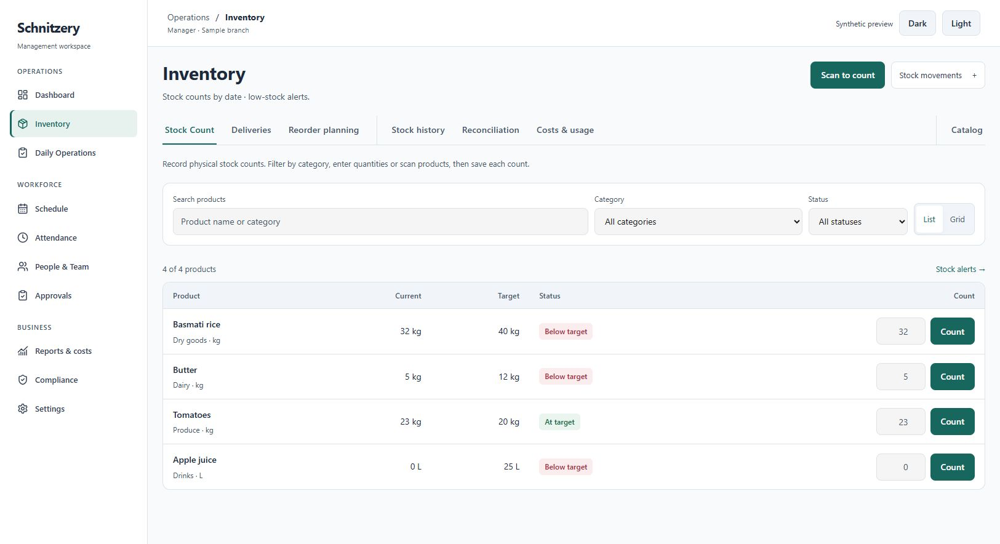

# Portal UI/UX pass — 2026-10-22

## Scope and honest status

The C/D response was read and its ten-finding safe-behaviour check passes. This UI pass scans all 65 page entry files for shared presentation patterns and improves the common shell plus Inventory and Analytics. It does **not** certify every interaction on every page. Suggestions below are acceptance targets, not claims that each workflow was redesigned or visually verified.

Branch: `codex/portal-ui-consistency`. Changes are local; no push, deployment, migration or production data changes were performed.

## Applied

- Existing light slate/white/teal palette retained. Legacy gold-tinted selected controls now derive their tint from the action token in both themes. No new styling dependency.
- Primary page-title divs became real headings; staff detail name now uses the body typeface and a primary heading.
- Shared desktop header shows the current section and a return link for related pages. Sidebar highlighting now covers checklists, personal hours/timesheets, notifications and the simulator. Header search/profile controls are labelled and keyboard accessible.
- Shared controls, tab scrolling, table containment, dialog scrolling, mobile field sizing, print layout and long-content wrapping improved. Management retains the full workspace width; focused employee/authentication forms retain their reading widths.
- Inventory groups operational tabs, review tabs and catalogue setup; movements open in a compact menu. Count rows are native forms, support Enter, retain input on a failed save and release the busy state for retry. Failed initial loading shows a retry action rather than a false empty catalogue.
- Analytics groups period/date/branch controls with visible labels, adds a business-loading skeleton and uses a responsive metric grid.
- One previously uncontained summary table now has a keyboard-accessible scroll region.

## Evidence

- `scripts/checks/review-c-d.cjs`: all ten findings asserted as fixed.
- 106 unit tests / 13 files passed.
- `tsc --noEmit` passed. The production build (`next build --webpack`) also completed successfully, including TypeScript, page generation and build traces. Webpack compilation took 6.8 minutes on this machine.
- Workspace UX, layout/navigation, action contrast, dashboard and business-UI checks passed. The workspace harness now targets ES2020 so Set iteration matches the app; the previous default transpilation could silently render an empty Set.
- New checks exercise actual inventory form handlers: submit, disconnect, retained input and successful retry; navigation checks cover related routes.
- Action text contrast: light 6.69:1; dark 7.72:1. These results cover action tokens, not every text/background combination.
- Desktop and 390px Inventory were inspected in a read-only source-rendered preview with synthetic data and the actual CSS. It uses mocked queries/components and is **not** a full Next.js staging session. Preview buttons do not persist data.
- Full signed-in staging acceptance, real device/print checks and the entire role/language/dialog matrix remain pending. The dedicated local staging server was offline.

[390px mobile preview](ui-review/inventory-mobile.png). The native movements menu was also checked for containment at this width. These are synthetic source previews, not staging acceptance screenshots.

## Page-by-page follow-up

“Source updated” means that page has a direct edit in this pass. “Shared foundation” means only inherited shell/CSS changes; it is not a route-specific redesign. Redirects have no separate visual page.

| Route | This pass | Next visual/workflow check |
| --- | --- | --- |
| `/action` | Source updated | Keep exception evidence above the decision buttons; verify long notes and failure recovery. |
| `/analytics` | Source updated | Applied: combined labelled period/date/branch toolbar, loading state, responsive metric grid. Verify all report views with populated data. |
| `/announcements` | Source updated | Separate composing from history; verify long German announcements and publish errors. |
| `/approvals` | Source updated | Keep pending decisions first and history secondary; check populated decisions, focus return and retry. |
| `/assistant` | Shared foundation | AI deferred; preserve the existing screen without adding new AI controls. |
| `/attendance-hub` | Source updated | Use summary first, exceptions second, tools last; verify tab state and populated corrections. |
| `/attendance/corrections` | Source updated | Show requested and recorded times together; verify review notes, keyboard access and rejected saves. |
| `/attendance` | Source updated | Keep live status, date controls and records together; check long teams and narrow-screen row actions. |
| `/audit` | Shared foundation | Keep actor/date/action filters above evidence; verify long JSON/details remain readable without page overflow. |
| `/availability` | Shared foundation | Keep week and submission state together; check employee mobile completion and unsaved edits. |
| `/branches/[id]` | Shared foundation | Keep branch identity above team/settings panels; check narrow-width details and permission failures. |
| `/branches` | Shared foundation | Use comparable branch summaries and explicit branch context; verify HQ-only navigation and branch switching. |
| `/checklist-status` | Source updated | Keep branch/date filters above completion status; verify long task names and unavailable data. |
| `/checklist` | Shared foundation | Keep current shift tasks first; verify disabled/completed states and retry without losing progress. |
| `/clock-display` | Shared foundation | Keep the clock code dominant with expiry/connection state nearby; test timer and reconnection. |
| `/compliance` | Source updated | Order exceptions by urgency with evidence and corrective action together; verify long German labels. |
| `/conflicts` | Source updated | Keep conflict evidence adjacent to the relevant roster action; test dense weeks and empty results. |
| `/cover` | Source updated | Keep shift details and response state together; verify employee and manager variants. |
| `/dashboard` | Redirect | Redirect only; do not create another dashboard. |
| `/directory` | Shared foundation | Keep staff search above results; verify names/contact details wrap and expose only permitted information. |
| `/expiring-docs` | Source updated | Group by urgency and keep employee/document/expiry together; verify missing dates and denied downloads. |
| `/expiry` | Source updated | Keep expiry date and stock identity visible in each record; verify phone forms and save failures. |
| `/export` | Source updated | Keep month, approval state and completeness above download actions; verify approved/draft exports and long tables. |
| `/geofence` | Source updated | Keep location evidence separate from editable radius settings; verify mobile controls and failed saves. |
| `/hours` | Shared foundation | Keep period and approved/draft status visible; verify long histories and missing wage information. |
| `/incidents` | Shared foundation | Separate reporting from history; verify evidence, severity and resolution actions on narrow screens. |
| `/inventory/order` | Source updated | Keep supplier/order lines and totals together; verify incomplete prices, horizontal scrolling and print output. |
| `/inventory` | Source updated | Applied: daily-work/review/catalogue tab groups, compact movements menu, count forms supporting Enter and failed-save retry; preview checked at desktop and 390px. |
| `/kiosks` | Source updated | Keep device status, last seen and configuration separate; test offline devices and confirmation dialogs. |
| `/labels` | Source updated | Keep product selection before print controls; verify actual printed dimensions and multiple labels. |
| `/labor` | Source updated | Keep sales entry separate from computed labour results; verify unconfirmed wages and date-window warnings. |
| `/leave-calendar` | Shared foundation | Keep branch/month filters visible; verify overlapping requests and non-colour status cues. |
| `/leave` | Source updated | Keep balance/request/history distinct; test employee mobile form and validation feedback. |
| `/my-day` | Source updated | Keep clock state and today's shift primary; verify break, offline and pending-review states on a phone. |
| `/noshow` | Shared foundation | Put affected shift evidence before reminder actions; verify empty/error states and translated labels. |
| `/notes` | Source updated | Keep employee and note visibility explicit; check long notes, search and permission errors. |
| `/notifications` | Source updated | Keep unread state and destination clear; verify keyboard navigation and long messages. |
| `/ops` | Source updated | Prioritise current operational exceptions; keep routine logs and administration secondary. |
| `/overview` | Source updated | Keep branch comparison aligned with period controls; verify complete versus partial financial figures. |
| `/` | Shared foundation | Keep exceptions and business KPIs above fold; verify manager and HQ data separately; avoid destination-card duplication. |
| `/people-hub` | Source updated | Keep directory and staff administration distinguishable; verify that hub links add useful context. |
| `/profile` | Source updated | Applied: accessible profile link in shared header. Verify personal documents, administration and sign-out grouping. |
| `/roster` | Source updated | Keep week/team controls near the editor; test horizontal navigation, conflicts and unsaved-change recovery. |
| `/schedule-hub` | Source updated | Keep roster editing as primary action; check insights/conflicts/tools hierarchy with populated weeks. |
| `/schedule/compare` | Source updated | Keep comparison periods and legend visible; verify tablet widths and differences without colour alone. |
| `/schedule` | Source updated | Keep personal shifts primary for employees; verify week navigation, long shift names and status cues. |
| `/schedule/shift-times` | Source updated | Keep reusable time templates distinct from actual shifts; verify edit/delete confirmation and retry. |
| `/search` | Source updated | Keep query and scope above grouped results; verify no matches versus unavailable search. |
| `/settings-hub` | Redirect | Redirect only; do not create another settings hub. |
| `/settings` | Shared foundation | Group operational settings with clear save scope; verify unsaved edits and rejected saves. |
| `/simulator` | Source updated | Keep assumptions before projections; verify incomplete inputs do not yield apparently final results. |
| `/staff/[id]` | Source updated | Applied: employee name is a readable primary heading. Verify details, documents and wage-history sections at phone width. |
| `/staff` | Source updated | Keep search/status filters above people; verify add/edit/deactivate dialogs and long names. |
| `/stock-alerts` | Source updated | Keep stock identity, last count and shortage together; distinguish uncounted from genuinely low stock. |
| `/summary` | Source updated | Applied: keyboard-accessible table scroll region and theme-aware actions. Verify complete/partial exports and print readability. |
| `/temp` | Source updated | Keep equipment and required range beside the reading; verify invalid values and unresolved exceptions. |
| `/timesheet` | Source updated | Keep month and approval status above entries; verify draft/approved distinctions on employee mobile. |
| `/transfers` | Source updated | Keep requested/sent/received steps explicit; verify branch labels, quantities and failed transition recovery. |
| `/waste-branches` | Source updated | Keep comparison period and branch context visible; verify missing values and narrow-screen charts. |
| `/waste` | Source updated | Keep product/unit/quantity/reason together; verify phone entry and historical filtering. |
| `/change-password` | Shared foundation | Check validation guidance and keyboard flow; preserve focused form width. |
| `/kiosk` | Shared foundation | Test QR/code size and status at actual tablet distance; preserve its standalone layout. |
| `/login` | Shared foundation | Check password visibility, error placement, autofill and keyboard submission; preserve focused authentication layout. |
| `/privacy` | Shared foundation | Keep legal content at readable width; check heading order and link focus. |
| `/terms` | Shared foundation | Keep legal content at readable width; check heading order and link focus. |

## Recommended next sequence

1. Run signed-in staging acceptance for Inventory, Analytics, Roster, Approvals and payroll export at 390/768/1280/1920px; include German, keyboard, partial data and disconnections.
2. Finish staff/documents/settings and daily logs against the page checklist above.
3. Check employee, manager and HQ flows separately. Keep screenshots and acceptance results per route.
4. Fix measured problems in shared controls first. Do not add another UI framework or replace working business logic for visual consistency.
